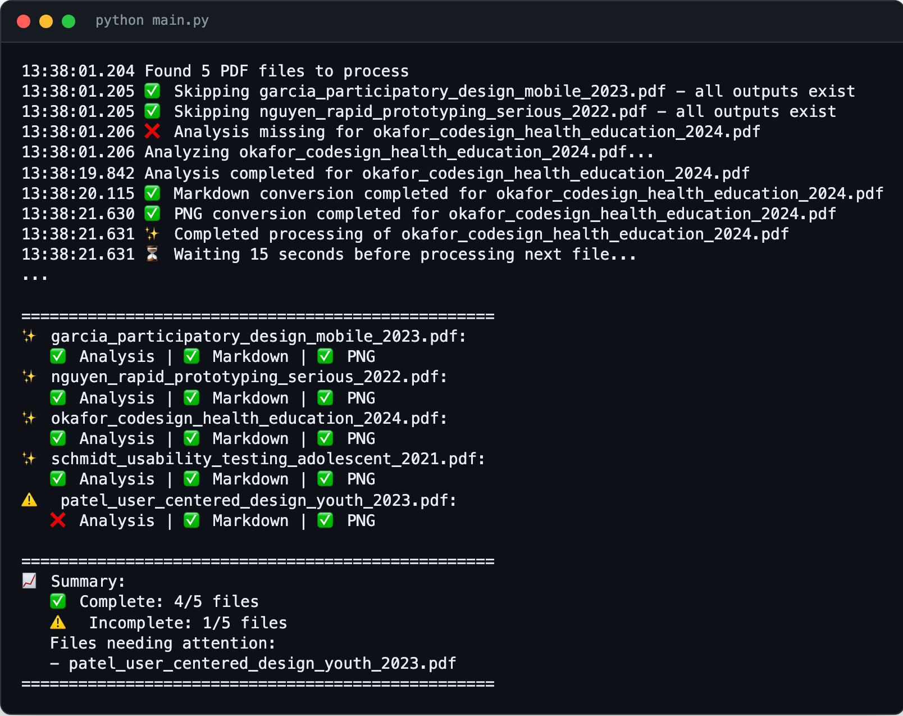

<div align="center">

<h1>research-assistant</h1>

<p><b>A folder of PDFs, turned into review material.</b></p>

<p><i>Drop papers into one folder, and each comes out renamed, summarised by Gemini, and split into text and page images ready for a literature review.</i></p>

<h6>


</h6>

<a href="#how-it-works"><b>How it works</b></a> ·
<a href="#run-it"><b>Run it</b></a> ·
<a href="#scripts"><b>Scripts</b></a>

<br><br>



<sub>Sample output in the script's real format, with made-up paper filenames. Not a live run.</sub>

</div>

<br>

A small personal workspace from early 2025, built while writing a systematic review on
user-centred design and rapid prototyping in health education technology for young people.
It handles the mechanical part of the reading pile. It is an experiment and no longer
maintained; [literature-review-assistant](https://github.com/parthchandak02/literature-review-assistant)
is a later, much fuller take on the same job.

## How it works

`main.py` walks every PDF in `sources_pdf/` and, for each one that is missing an output:

1. **Analyse.** Uploads the PDF to Gemini (`gemini-3.8-flash` by default, override with `GEMINI_MODEL_NAME`) and asks for
   title, authors, year, abstract, findings, methodology, results, limitations, research gap
   and themes. The answer is saved as `sources_analysis/<name>_analysis.xml`.
2. **Rename.** Renames the PDF to `firstauthor_short_title_year.pdf` from that analysis.
3. **Convert.** Writes the text of each page to `sources_markdown/<name>.md` and renders
   every page to `sources_png/<name>/` with PyMuPDF.
4. **Report.** Prints a per-file checklist of what exists and what still needs attention.

Files that are already complete are skipped, so it is safe to re-run. It waits 15 seconds
between files and 5 minutes after a quota error, with three retries per step.

## Run it

Requires Python 3.8+, a [Gemini API key](https://ai.google.dev) and, for Word export, Pandoc.

```bash
git clone https://github.com/parthchandak02/research-assistant.git
cd research-assistant
pip install -r requirements.txt
cp example.env .env                  # set GEMINI_API_KEY
python main.py                       # process everything in sources_pdf/
python main.py --list                # list the PDFs it can see
python main.py --file paper.pdf      # process one file
```

Nothing writes the review for you. Start `draft.md` from [`template_draft.md`](template_draft.md),
write it, then build a Word file with narrow margins and academic table styles:

```bash
cp template_draft.md draft.md
./scripts/convert_to_docx.sh         # draft.md -> draft.docx via pandoc + python-docx
./scripts/convert_to_docx.sh my.md   # or any other Markdown file -> my.docx
```

## Scripts

| | |
|---|---|
| `main.py` | Runs analyse, rename, Markdown and PNG for every PDF, then prints the status report |
| `scripts/pdf_analyze.py` | Gemini file upload, structured XML analysis (fixed tag list shared by prompt and parser), IEEE-style rename |
| `scripts/pdf_to_markdown.py` | Page-by-page text extraction to Markdown (PyMuPDF) |
| `scripts/pdf_to_png.py` | One PNG per page (PyMuPDF) |
| `scripts/convert_to_docx.py`, `.sh` | Markdown to DOCX through Pandoc with a generated reference style |
| `user_vos_diagram/` | Notes on VOSviewer for bibliometric maps |

Writing conventions for the draft (headings, tables, citations) live in
[`.cursorrules`](.cursorrules), which doubles as the AI editor's rules file.

<br>

<div align="center">
<sub>Built with Google Gemini, PyMuPDF, Pandoc and python-docx.</sub>
</div>
